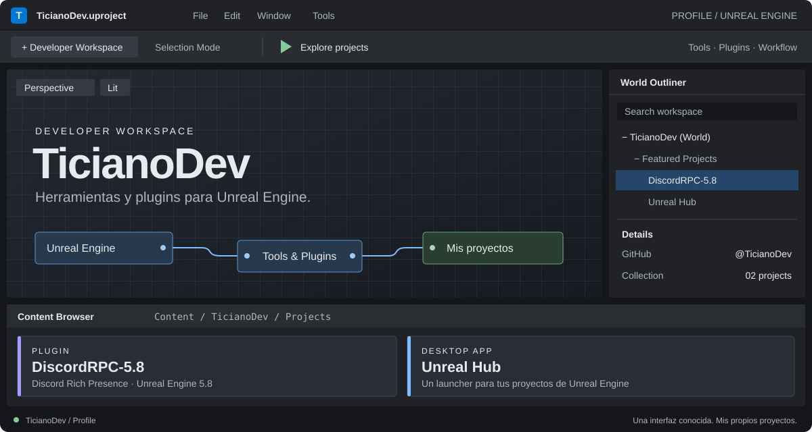

  

<h1 align="center">Hola, soy Ticiano 👋</h1>

Herramientas y plugins para el ecosistema de <strong>Unreal Engine</strong>.

  <a href="https://github.com/TicianoDev?tab=repositories">Repositorios</a> ·
  <a href="#-content-browser">Mis proyectos</a>

## 📁 Content Browser

> `Content / TicianoDev / Projects` — Dos proyectos, un mismo ecosistema.

<table>
<tr>
<td width="50%" valign="top">

### DiscordRPC-5.8

`PLUGIN` · `UNREAL ENGINE 5.8` · `DISCORD`

Discord Rich Presence para Unreal Engine, actualizado y probado para **UE 5.8**.

Conectá tu juego con Discord y actualizá su presencia mediante nodos de Blueprint.

[**Abrir repositorio →**](https://github.com/TicianoDev/DiscordRPC-5.8)  
[Descargar última versión](https://github.com/TicianoDev/DiscordRPC-5.8/releases/latest)

Fork de <a href="https://github.com/LouisRaverdy/DiscordRPC">LouisRaverdy/DiscordRPC</a>.

</td>
<td width="50%" valign="top">

### Unreal Hub

`DESKTOP APP` · `ELECTRON` · `WINDOWS`

Un launcher de escritorio para encontrar, organizar y abrir tus proyectos de **Unreal Engine**.

Biblioteca con filtros, seguimiento de sesiones del editor y herramientas para gestionar proyectos. Funciona sin conexión y sin telemetría.

[**Abrir repositorio →**](https://github.com/TicianoDev/unreal-hub)  
[Descargar última versión](https://github.com/TicianoDev/unreal-hub/releases/latest)

Diseñado y programado por jsTici y Zorac.

</td>
</tr>
</table>

<strong>▸ Output Log / Créditos</strong>

 

- **DiscordRPC-5.8:** fork del plugin de [LouisRaverdy](https://github.com/LouisRaverdy/DiscordRPC), actualizado para Unreal Engine 5.8.
- **Unreal Hub:** créditos de diseño y programación a **jsTici y Zorac**, según el repositorio.
- Diseño del perfil inspirado en la organización visual de Unreal Editor. No es una interfaz interactiva ni un producto oficial de Epic Games.
- Unreal Engine es una marca de Epic Games. Este perfil no está afiliado a Epic Games.

---

END OF FRAME · <a href="https://github.com/TicianoDev">@TicianoDev</a>

