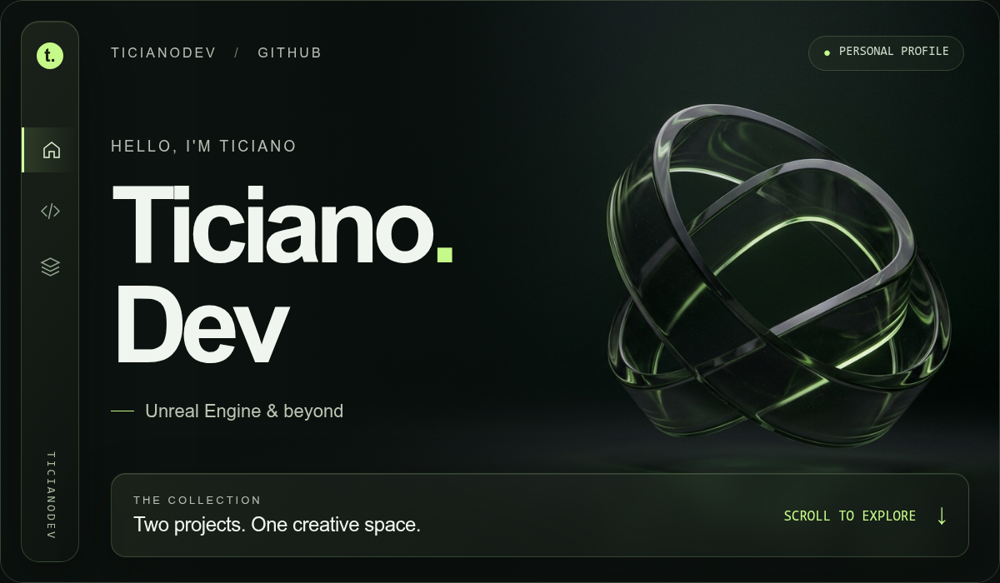
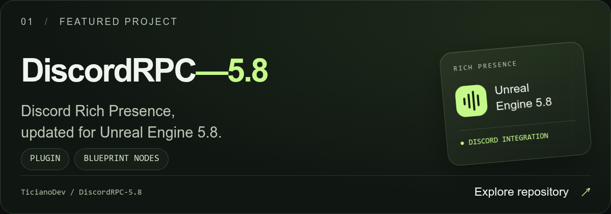
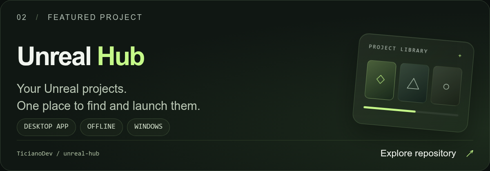

[Repository](https://github.com/TicianoDev/DiscordRPC-5.8) · [Latest release](https://github.com/TicianoDev/DiscordRPC-5.8/releases/latest)

[Repository](https://github.com/TicianoDev/unreal-hub) · [Latest release](https://github.com/TicianoDev/unreal-hub/releases/latest)

---

**Credits** — DiscordRPC-5.8 is a fork of [LouisRaverdy/DiscordRPC](https://github.com/LouisRaverdy/DiscordRPC). Unreal Hub is designed and programmed by **jsTici & Zorac**, as credited in its [README](https://github.com/TicianoDev/unreal-hub#readme).
